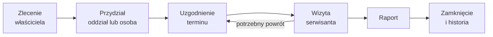

<div align="center">


<h1>Serwio</h1>

<p>
  Platforma do obsługi zleceń serwisowych: od zgłoszenia przez właściciela obiektu<br />
  po wizytę serwisanta, raport i historię prac.
</p>

<p>
  <a href="docs/serwio_specyfikacja_v0.1.md"><strong>Specyfikacja »</strong></a>
  <br />
  <br />
  <a href="#uruchomienie">Uruchomienie</a>
  &middot;
  <a href="docs/testing.md">Testy</a>
  &middot;
  <a href="https://github.com/serwio-team/serwio/issues/new?labels=bug">Zgłoś błąd</a>
</p>

[![CI][ci-shield]][ci-url]

</div>

## O projekcie


Serwio łączy trzy strony zlecenia serwisowego w jednej aplikacji webowej. Właściciel
obiektu, czyli np. restauracja, hotel lub zakład, zgłasza naprawę albo przegląd urządzenia.
Firma serwisowa przydziela je oddziałom i serwisantom. Serwisant uzgadnia termin, wykonuje
wizytę i przygotowuje raport, który zostaje w historii obiektu.

Model nie zakłada jednej branży: obiektem może być pompa ciepła, klimatyzator, ekspres do
kawy albo linia produkcyjna.

## Jak to działa

| Rola | Co robi w Serwio |
| --- | --- |
| **Właściciel obiektu** | Zakłada konto, dodaje lokalizacje z godzinami dostępności i urządzenia, tworzy zlecenia, akceptuje terminy i potwierdza wykonanie |
| **Firma serwisowa** | Zarządza oddziałami i serwisantami, przydziela zlecenia całym oddziałom lub wybranym osobom, planuje wizyty i zamyka zlecenia |
| **Serwisant** | Widzi zlecenia swojego oddziału i własne, proponuje terminy, realizuje wizyty i pisze raport |



Proponowany termin musi mieścić się w godzinach dostępności lokalizacji i nie może
kolidować z innymi wizytami wykonawców. Backend sprawdza to także w chwili akceptacji.

### Technologie

[![Java][java-shield]][java-url]
[![Spring Boot][spring-shield]][spring-url]
[![PostgreSQL][postgres-shield]][postgres-url]
[![React][react-shield]][react-url]
[![TypeScript][ts-shield]][ts-url]
[![Vite][vite-shield]][vite-url]
[![TanStack Query][tanstack-shield]][tanstack-url]

## Uruchomienie

### Wymagania

- JDK 21
- Node.js 24
- Docker, tylko przy trwałej bazie PostgreSQL

### Szybki start bez Dockera

1. Skopiuj konfigurację w głównym folderze repozytorium:
   ```sh
   cp .env.example .env
   ```
2. W pliku `.env` ustaw tymczasową bazę i hasło kont testowych:
   ```sh
   TEMP_DB=true
   SEED_DATA=true
   SEED_PASSWORD=wybierz-wlasne-haslo
   ```
3. Uruchom backend na `localhost:8080`:
   ```sh
   cd serwio-backend
   ./mvnw spring-boot:run
   ```
4. W drugim terminalu uruchom frontend:
   ```sh
   cd serwio-frontend
   npm ci
   npm run dev
   ```
5. Otwórz <http://localhost:5173/sign-in> i zaloguj się jednym z kont testowych.

| Konto | Rola |
| --- | --- |
| `owner@example.com` | Właściciel z lokalizacją i dwoma urządzeniami |
| `company@example.com` | Firma serwisowa z oddziałem |
| `technician@example.com` | Serwisant tego oddziału |

Hasłem każdego konta jest `SEED_PASSWORD`. Baza H2 działa w pamięci, więc dane znikają
po zatrzymaniu backendu. Nowego właściciela można też zarejestrować na `/sign-up`.

### Trwała baza PostgreSQL

Ustaw `TEMP_DB=false` i własne `DB_PASSWORD`. Backend sam uruchomi kontener PostgreSQL 17
z `serwio-backend/compose.yaml`. Opis wszystkich zmiennych znajdziesz w
[`.env.example`](.env.example).

## Testy

```sh
cd serwio-backend && ./mvnw verify
cd serwio-frontend && npm test && npm run build
```

Backend ma testy reguł domenowych, testy API oraz dwa pełne scenariusze HTTP: naprawę
i przegląd z ponowną wizytą. Raport pokrycia JaCoCo powstaje w
`serwio-backend/target/site/jacoco`. GitHub Actions uruchamia te testy dla każdego PR-a,
a scenariusze HTTP także na PostgreSQL 17. Szczegóły: [docs/testing.md](docs/testing.md).

## Dokumentacja

- [Specyfikacja MVP](docs/serwio_specyfikacja_v0.1.md): pojęcia, role, procesy i bezpieczeństwo
- [Wygląd aplikacji](docs/design.md): znak, kolory, statusy i typografia
- [Diagram ERD](docs/erd/serwio_erd_mvp_diagram.png) i [słownik pojęć](docs/erd/serwio_erd_mvp_slownik_pojec.md)
- Kontrakty API: [przydziały](docs/order-assignment.md), [zlecenia serwisanta](docs/technician-orders.md), [wizyty](docs/service-visits.md), [raporty](docs/service-reports.md), [dostępność lokalizacji](docs/location-availability.md)

## Plany rozwoju

- [x] Konta i role: właściciel, firma, serwisant
- [x] Lokalizacje z tygodniową dostępnością i urządzenia
- [x] Zlecenia z przydziałem do oddziałów i osób
- [x] Wizyty, uzgadnianie terminów i raport serwisowy
- [ ] Kody QR identyfikujące obiekt
- [ ] Zdjęcia i dokumenty
- [ ] Zgłoszenia usterek od klientów końcowych
- [ ] Aplikacja mobilna serwisanta
- [ ] Wiele firm na jednej platformie (SaaS)

## Autorzy

<a href="https://github.com/serwio-team/serwio/graphs/contributors">
  
</a>

<!-- LINKI I OBRAZY -->
[ci-shield]: https://github.com/serwio-team/serwio/actions/workflows/ci.yml/badge.svg?branch=main
[ci-url]: https://github.com/serwio-team/serwio/actions/workflows/ci.yml
[java-shield]: https://img.shields.io/badge/Java_21-ED8B00?style=for-the-badge&logo=openjdk&logoColor=white
[java-url]: https://openjdk.org/
[spring-shield]: https://img.shields.io/badge/Spring_Boot_4-6DB33F?style=for-the-badge&logo=springboot&logoColor=white
[spring-url]: https://spring.io/projects/spring-boot
[postgres-shield]: https://img.shields.io/badge/PostgreSQL_17-4169E1?style=for-the-badge&logo=postgresql&logoColor=white
[postgres-url]: https://www.postgresql.org/
[react-shield]: https://img.shields.io/badge/React_18-20232A?style=for-the-badge&logo=react&logoColor=61DAFB
[react-url]: https://react.dev/
[ts-shield]: https://img.shields.io/badge/TypeScript-3178C6?style=for-the-badge&logo=typescript&logoColor=white
[ts-url]: https://www.typescriptlang.org/
[vite-shield]: https://img.shields.io/badge/Vite-646CFF?style=for-the-badge&logo=vite&logoColor=white
[vite-url]: https://vite.dev/
[tanstack-shield]: https://img.shields.io/badge/TanStack_Query-FF4154?style=for-the-badge&logo=reactquery&logoColor=white
[tanstack-url]: https://tanstack.com/query
