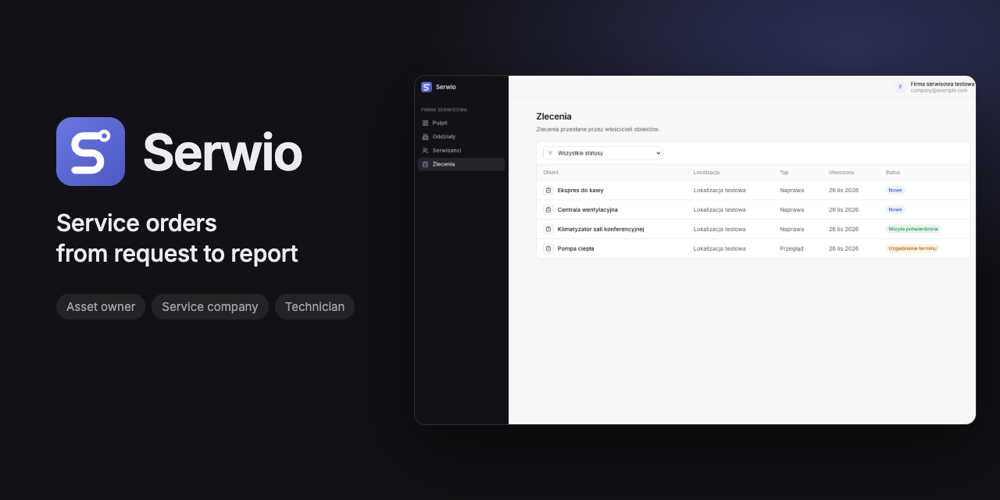
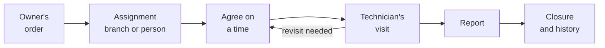
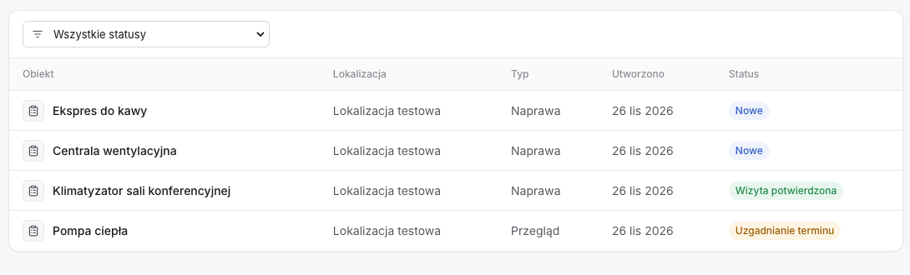
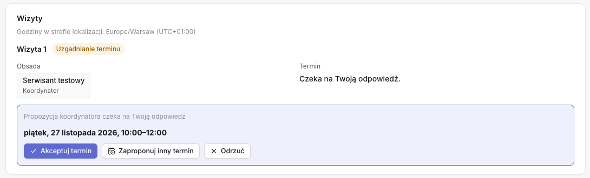
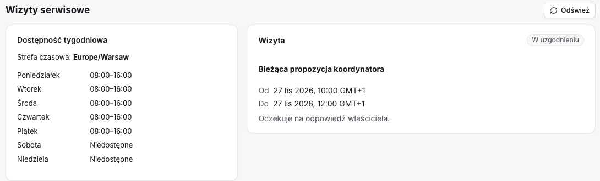

<div align="center">


<h1>Serwio</h1>

<p>
  A platform for service work orders: from an asset owner's request<br />
  to a technician's visit, the service report and the maintenance history.
</p>

<p>
  <a href="docs/serwio_specyfikacja_v0.1.md"><strong>Read the specification »</strong></a>
  <br />
  <br />
  <a href="#getting-started">Getting started</a>
  &middot;
  <a href="docs/testing.md">Tests</a>
  &middot;
  <a href="https://github.com/serwio-team/serwio/issues/new?labels=bug">Report a bug</a>
</p>

[![CI][ci-shield]][ci-url]

</div>

## About the project



Serwio brings all three parties of a service order into one web app. An asset owner, such as
a restaurant, hotel or factory, requests a repair or an inspection of a device. The service
company assigns the order to its branches and technicians. A technician agrees on a time,
carries out the visit and writes a report that stays in the asset's history.

The model is not tied to one industry: an asset can be a heat pump, an air conditioner,
a coffee machine or a production line. The interface is in Polish.

## How it works

| Role | What they do in Serwio |
| --- | --- |
| **Asset owner** | Signs up, adds locations with opening hours and devices, creates orders, accepts visit times and confirms completed work |
| **Service company** | Manages branches and technicians, assigns orders to whole branches or selected people, plans visits and closes orders |
| **Technician** | Sees orders for their branch and their own, proposes visit times, carries out visits and writes the report |



A proposed visit must fit within the location's opening hours and must not clash with other
visits of the assigned technicians. The backend checks this again when the time is accepted.

## Screenshots

<table>
  <tr>
    <td width="33%"><a href="docs/images/company-orders.png"></a></td>
    <td width="33%"><a href="docs/images/owner-visit-proposal.png"></a></td>
    <td width="33%"><a href="docs/images/technician-order.png"></a></td>
  </tr>
  <tr>
    <td align="center"><b>Service company</b><br />order list with statuses</td>
    <td align="center"><b>Asset owner</b><br />accepting a visit time</td>
    <td align="center"><b>Technician</b><br />visit and opening hours</td>
  </tr>
</table>

## Built with

[![Java][java-shield]][java-url]
[![Spring Boot][spring-shield]][spring-url]
[![PostgreSQL][postgres-shield]][postgres-url]
[![React][react-shield]][react-url]
[![TypeScript][ts-shield]][ts-url]
[![Vite][vite-shield]][vite-url]
[![TanStack Query][tanstack-shield]][tanstack-url]

## Getting started

### Prerequisites

- JDK 21
- Node.js 24
- Docker, only for the persistent PostgreSQL database

### Quick start without Docker

1. Copy the configuration in the repository root:
   ```sh
   cp .env.example .env
   ```
2. In `.env`, switch to the temporary database and set the test account password:
   ```sh
   TEMP_DB=true
   SEED_DATA=true
   SEED_PASSWORD=choose-your-own-password
   ```
3. Start the backend on `localhost:8080`:
   ```sh
   cd serwio-backend
   ./mvnw spring-boot:run
   ```
4. In a second terminal, start the frontend:
   ```sh
   cd serwio-frontend
   npm ci
   npm run dev
   ```
5. Open <http://localhost:5173/sign-in> and sign in with one of the test accounts.

| Account | Role |
| --- | --- |
| `owner@example.com` | Asset owner with a location and two devices |
| `company@example.com` | Service company with one branch |
| `technician@example.com` | Technician in that branch |

Every account uses `SEED_PASSWORD`. The H2 database lives in memory, so the data is gone
once the backend stops. You can also register a new asset owner at `/sign-up`.

### Persistent PostgreSQL database

Set `TEMP_DB=false` and your own `DB_PASSWORD`. The backend starts a PostgreSQL 17 container
from `serwio-backend/compose.yaml` on its own. All variables are described in
[`.env.example`](.env.example).

## Tests

```sh
cd serwio-backend && ./mvnw verify
cd serwio-frontend && npm test && npm run build
```

The backend has domain rule tests, API tests and two end-to-end HTTP scenarios: a repair
and an inspection that needs a second visit. The JaCoCo coverage report is written to
`serwio-backend/target/site/jacoco`. GitHub Actions runs these tests on every pull request
and runs the HTTP scenarios on PostgreSQL 17 as well. Details: [docs/testing.md](docs/testing.md).

## Documentation

The documents below are written in Polish.

- [MVP specification](docs/serwio_specyfikacja_v0.1.md): terms, roles, processes and security
- [Design guide](docs/design.md): logo, colours, statuses and typography
- [ERD diagram](docs/erd/serwio_erd_mvp_diagram.png) and [glossary](docs/erd/serwio_erd_mvp_slownik_pojec.md)
- API contracts: [assignments](docs/order-assignment.md), [technician orders](docs/technician-orders.md), [visits](docs/service-visits.md), [reports](docs/service-reports.md), [location availability](docs/location-availability.md)

## Roadmap

- [x] Accounts and roles: owner, company, technician
- [x] Locations with weekly opening hours, and devices
- [x] Orders assigned to branches and people
- [x] Visits, scheduling and the service report
- [ ] QR codes that identify an asset
- [ ] Photos and documents
- [ ] Fault reports from end customers
- [ ] Mobile app for technicians
- [ ] Multiple companies on one platform (SaaS)

## Contributors

<a href="https://github.com/serwio-team/serwio/graphs/contributors">
  
</a>

<!-- LINKS AND IMAGES -->
[ci-shield]: https://github.com/serwio-team/serwio/actions/workflows/ci.yml/badge.svg?branch=main
[ci-url]: https://github.com/serwio-team/serwio/actions/workflows/ci.yml
[java-shield]: https://img.shields.io/badge/Java_21-ED8B00?style=for-the-badge&logo=openjdk&logoColor=white
[java-url]: https://openjdk.org/
[spring-shield]: https://img.shields.io/badge/Spring_Boot_4-6DB33F?style=for-the-badge&logo=springboot&logoColor=white
[spring-url]: https://spring.io/projects/spring-boot
[postgres-shield]: https://img.shields.io/badge/PostgreSQL_17-4169E1?style=for-the-badge&logo=postgresql&logoColor=white
[postgres-url]: https://www.postgresql.org/
[react-shield]: https://img.shields.io/badge/React_18-20232A?style=for-the-badge&logo=react&logoColor=61DAFB
[react-url]: https://react.dev/
[ts-shield]: https://img.shields.io/badge/TypeScript-3178C6?style=for-the-badge&logo=typescript&logoColor=white
[ts-url]: https://www.typescriptlang.org/
[vite-shield]: https://img.shields.io/badge/Vite-646CFF?style=for-the-badge&logo=vite&logoColor=white
[vite-url]: https://vite.dev/
[tanstack-shield]: https://img.shields.io/badge/TanStack_Query-FF4154?style=for-the-badge&logo=reactquery&logoColor=white
[tanstack-url]: https://tanstack.com/query
